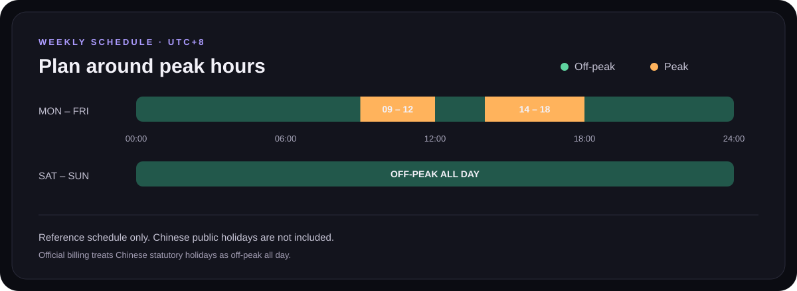
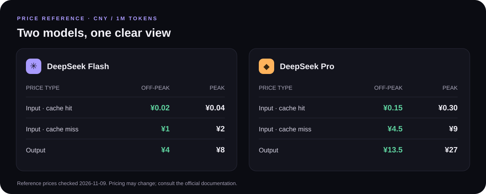

# DeepSeek Price Monitor

A static, single-page tool for checking DeepSeek API peak and off-peak hours. See the current rate, countdown, weekly schedule, and Flash and Pro prices in **English** or Chinese — all in your browser, with no account or API key.

**Live:** https://chengwq95.github.io/deepseek-monitor/

[Official DeepSeek pricing](https://api-docs.deepseek.com/zh-cn/quick_start/pricing/)

## Weekly schedule

From Monday to Friday, peak hours are **09:00–12:00** and **14:00–18:00**. All other hours and all weekends are off-peak. A transition takes effect at the exact boundary shown. The dashboard uses your device's clock and a fixed UTC+8 offset.

**Holiday limitation:** This is a weekly reference only. It does not recognize Chinese statutory holidays or make-up workdays. DeepSeek states that Chinese statutory holidays are off-peak all day, so the dashboard may show a peak period on a weekday holiday when actual billing is off-peak. Always check the official pricing page for current billing rules.

## Flash and Pro pricing

The illustrated prices are in **CNY per million tokens** and were checked against the official page on **2026-11-09**. They are static references and may change. The dashboard's prices and check date are maintained in `CONFIG` at the top of `app.js`.

## Features

- Live status, Beijing clock, and a countdown to the next transition, including across weekends.
- Seven-day schedule, upcoming transitions, and highlighted prices for the current period.
- A date and time simulator with an explicit simulation indicator.
- Optional browser notification before peak hours; simulation mode does not send notifications.
- **EN / 中文** interface switch and responsive light and dark themes. Language and theme choices are saved in your browser.

Notifications require a supported browser, permission, HTTPS or localhost, and an open page. Browser background restrictions or device sleep can delay or prevent delivery. Enable the reminder again after reopening the page.

## Run locally

Open `index.html` in a browser. For notifications, serve the folder from `localhost` or use an HTTPS deployment; browser support may vary.

## Deploy on GitHub Pages

1. Upload the project files to the root of a GitHub repository.
2. In **Settings → Pages**, choose **Deploy from a branch**, select `main` and `/ (root)`, then save.
3. When deployment completes, open the address shown in the Pages settings.

## Files

- `index.html` — page structure
- `style.css` — responsive styles and themes
- `app.js` — schedule, price configuration, simulation, and reminders
- `favicon.svg` — browser icon
- `readme-schedule.svg`, `readme-pricing.svg` — README illustrations

## License

[MIT](LICENSE)
